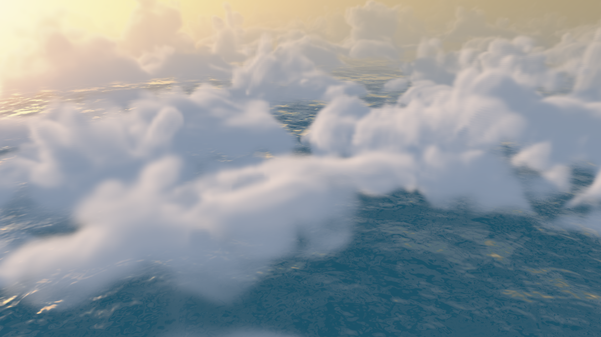

# Cloudscape

A Three.js flight above and below broken cloud banks over the ocean.

**[Fly through Cloudscape](https://ken-coffee-adachi.github.io/cloudscape/)**. Press play to start the flight.

Run `npm ci` and `npm run dev`; use `npm test` for the scene tests.

Play or pause the 36-second flight using the button in the lower right.
The scene fills the viewport; the raymarch uses 96 primary samples and at
most 230,400 drawing-buffer pixels at any aspect ratio. FPS is shown during
playback, and a paused view redraws only when it changes.

Each bank receives its own seeded altitude offset, by default up to 1.5 world units
above or below the reference base (12 units above sea level). Where two bank
bodies substantially overlap, the smaller bank borrows the broader bank's base
level. Isolated banks keep their own altitude. The finished density columns move vertically
together, including the wispy base and the rounded shoulders. Open-water
columns remain empty. Both view and shadow rays use this baked volume;
reflections use a cheaper 2D map of cloud depth and placement height.

Opening the plain URL gives a new layout. Use a URL such as
`?seed=739146852&time=36` for a repeatable layout and starting frame:

- Add `&groups=0` to compare the previous distribution of tall crowns. A few
  isolated extra towers now grow beside another tower on an existing thick bank.
  The number of sites and the underlying bank layout are unchanged.
- Add `&fray=0` to compare intact skirts with the same lighting. The new bake
  loosens low, thin edges near sea openings in patches, leaving tall crowns intact.
- Add `&sharedBases=0` to compare independent base heights at the same seed and time.
- Add `&thick=0` for the earlier, sparser tower distribution. The default grows
  additional stacks of billows on existing banks. The altitude offsets, thin
  skirts and water openings are independent of this switch.
- Add `&rims=0` to see the former low-hanging skirts. By default the base keeps
  its local level toward an opening, with a slight upward curl in patches.
  Compare `?seed=739146852&time=18` from below or `time=36` from above.
- Add `&headings=0` to compare the former world-axis-aligned billows. Each
  family now turns around its original center, with its buds turned by up to
  another 23 degrees. Bank layout, camera and per-frame sampling are unchanged.
- Add `&saddles=0` to see the previous rounded outlines. The default gives
  selected banks an offset summit, a shallow saddle and a lower shoulder.
  Both versions use the same bank layout and the same baked billows.
- `?seed=1862305441&time=18`: look up from near the sea; use `time=35.41` for the crowns.
- `altitude` scales the seeded offsets from `0` (common base) through `0.5`
  (default) to `1` (previous full range, up to three units either way).
  Compare `?seed=739146852&time=36` for the silhouette and `time=18` from below.
- Add `&shoulders=0` to compare the earlier towers. Seed zero retains the legacy layout and base.
- Add `&billows=0` to compare the former smooth puffs with the same bank placement.
  The default varies each growth puff's width and height and nests smaller lobes
  into its upper surface. This is baked into the volume, not evaluated per frame.
- Add `&fine=0` to remove only the third, finest scale and keep the same parent
  and child billows. By default selected exposed buds carry a cluster of roughly
  3-5-voxel-wide tips; the texture resolution and march settings are unchanged.

**Ocean surface.** Two long, travelling swells displace the water hit near
the camera; the horizon still uses the mean plane. Only the irregular ripple
field steers reflections, so long crests do not light up as parallel bands.
The visual reference is the short, unbroken wavelets in the NOAA
[sea-state photographs (Beaufort force 2)](https://www.weather.gov/images/marine/Sea_state_Beaufort%20-%20Large.jpg).
For sun glints,
the cloud-column map is sampled toward the sun independently of the reflected
sky direction. This adds no reflection pass or cloud-volume march.
Use `?seed=1862305441&time=10.67` to compare ripples during descent.
See [GPU Gems: Effective Water Simulation from Physical Models](https://developer.nvidia.com/gpugems/gpugems/part-i-natural-effects/chapter-1-effective-water-simulation-physical-models)
for the separation of swell height and ripple normals.

**Clear sky and lighting.** `src/sky.js` integrates Rayleigh and aerosol single
scattering with ozone absorption once at startup for the fixed sun and a sea-level observer. The
96 x 48 linear HDR sky-view map stores the upper hemisphere by elevation and
azimuth relative to the sun, with extra rows near the horizon. The camera can
turn and move through this low-altitude scene without rebaking the sky.
The background, distance haze and ocean reflection sample this map; the small
sun disc and its moving glints are kept separate. Cloud lighting uses two
colors from the same bake: attenuated sunlight and the cosine-weighted average
sky. No sky integration or environment lookup is needed inside the cloud march.
Long primary segments sample sunlight toward both ends of a translucent edge
and composite near to far. Dense or already obscured segments merge their light
probes; empty samples skip shadow tracing.
See the [Three.js Sky example](https://threejs.org/examples/webgl_shaders_sky.html)
for the scattering look and [Hillaire's sky-view LUT](https://diglib.eg.org/items/8a3e5350-18b3-46bd-9274-3add5af88c75)
for the caching approach. This is not a multiple-scattering atmosphere model.

The flight uses feathered edges, Worley lobes, sun shadows and cloud
reflection without separate switches. Earlier density experiments are still
represented in the source and tests.

[Takram three-clouds](https://github.com/takram-design-engineering/three-geospatial/tree/main/packages/clouds)
is a design reference for separating large shapes from erosion.
[Maxime Heckel](https://blog.maximeheckel.com/posts/real-time-cloudscapes-with-volumetric-raymarching/#sampling-light)
is a reference for sun-direction sampling. Neither implementation nor their textures are bundled here.

## License

Cloudscape's original code is licensed under the [MIT License](LICENSE).
Third-party code retains its own licenses; see the
[third-party notices](public/THIRD_PARTY_NOTICES.txt).
When distributing the demo, keep both `LICENSE` and `THIRD_PARTY_NOTICES.txt`
with the built files. `npm run build` puts both in `dist/`.
